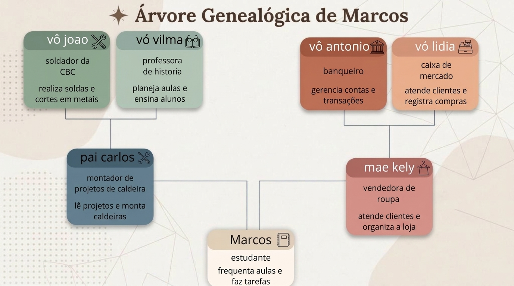

# 🌳 Árvore Genealógica de Marcos

Repositório dedicado ao mapeamento das gerações e profissões da minha família.

📄 **[Acesse aqui o documento completo da pesquisa (`pesquisa.md`)](https://github.com/Marcoscaselato/portfolio/blob/main/pesquisa.md)**

---

## 👨‍👩‍👦 Integrantes e Profissões

### Avós Paternos
* **Vô João:** Soldador da CBC — *realiza soldas e cortes em metais.*
* **Vó Vilma:** Professora de História — *planeja aulas e ensina alunos.*

### Avós Maternos
* **Vô Antônio:** Banqueiro — *gerencia contas e transações.*
* **Vó Lídia:** Caixa de mercado — *atende clientes e registra compras.*

### Pais
* **Pai Carlos:** Montador de projetos de caldeira — *lê projetos e monta caldeiras.*
* **Mãe Kely:** Vendedora de roupa — *atende clientes e organiza a loja.*

### Geração Atual
* **Marcos:** Estudante — *frequenta aulas e faz tarefas.*
